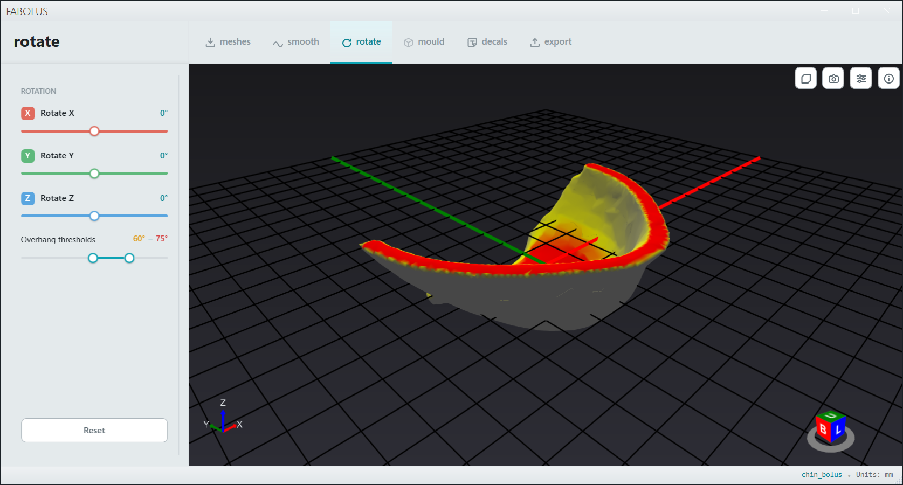

# Print Orientation & Overhangs

The **rotate** tab lets you orient the mesh and provides a visual aid to pinpoint potential overhang failure. Orientation matters because support structures printed inside a mould cavity are difficult to remove and can mar internal surface quality; physical printing and support generation happen later in your slicer.

---

## Overhang colouring

When the rotate tab is active, Fabolus colours the mesh by surface angle using a real-time gradient between two thresholds:

- **Warning angle** — default `45°` (yellow).
- **Critical angle** — default `65°` (red).

Surfaces shallower than the warning angle appear green (printable without support). Surfaces between the warning and critical thresholds appear yellow (moderate overhang), and surfaces steeper than the critical threshold appear red, pinpointing potential print failures and areas where supports will be required.

Both thresholds come from `RotationPreferences` and are adjustable via the range slider (kept at least 5° apart, within `30°`–`90°`).

---

## Seeing through the mesh

Lower the **Mesh opacity** slider to see the bed grid, the axes, and the far side of the mesh through the near side while you line the model up. It only changes how the mesh is drawn, and carries on across rotations until you leave the tab. To start the tab at a different opacity, set **Mesh opacity** on the **Rotation** page of the preferences.

> [!NOTE]
> Overhang colours from the near and far sides of the mesh mix where they overlap, so a grey surface in front of a red one can look orange. Return the slider to `100%` before judging overhangs from their colour.

---

## Rotating the mesh

- Drag the X, Y, or Z rotation rings around the mesh in the viewport to turn it, or adjust the angle sliders for each axis.
- The overhang colouring updates live as you rotate, allowing you to find an orientation that minimizes downward-facing red faces.
- **Reset** clears all rotations and returns the mesh to its original imported orientation.

A rotation is recorded as a transform command in the mesh's history.

> [!WARNING]
> **Downstream Invalidation**: Changing or resetting the rotation clears changes applied in the **mould**, **decals**, and **cut / split** views. Ensure you are satisfied with the print orientation before configuring mould walls, air channels, or decals.
